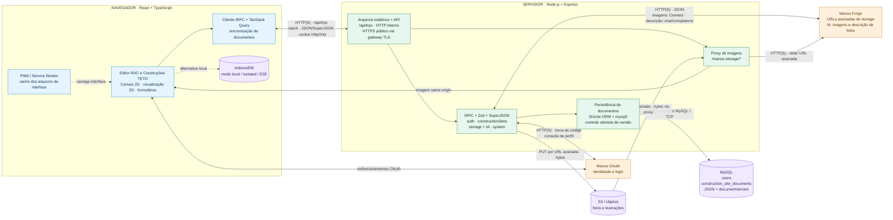
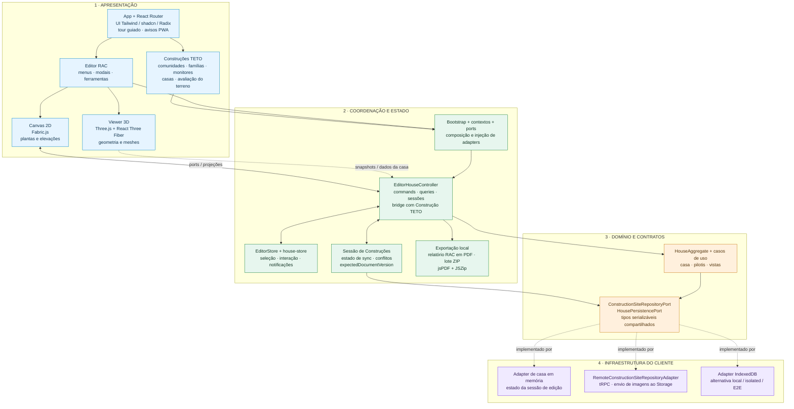
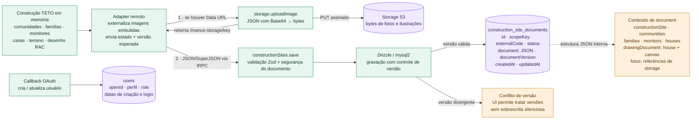

# RAC Designer TETO — arquitetura atual

Levantamento do código local em 05/10/2026. O objetivo é explicar módulos, camadas, comunicação e persistência; a implantação remota e seus recursos não foram inspecionados.

[Quadro tldraw concluído](https://www.tldraw.com/f/MtSP6Pa4uMRSSnWvPCIBR). Três páginas editáveis, com revisão visual por screenshot. A vista macro usa agrupamento manual dos componentes para facilitar a leitura; as páginas de detalhe foram renderizadas dos Mermaid.

## Como ler

- O navegador executa o editor e suas regras de domínio. A API Node/Express atende autenticação, documentos e integrações.
- A persistência normal usa MySQL: uma linha por Construção TETO, com casas, famílias e monitores dentro de um documento JSON.
- Fotos e ilustrações são objetos no S3; o documento guarda referências de Storage.
- IndexedDB é a alternativa para execução local/isolada e E2E, não um espelho offline geral da base remota.
- As setas internas do frontend representam chamadas/dados TypeScript no mesmo processo do navegador. As conexões externas têm protocolo indicado.
- O agrupamento “API” inclui os handlers HTTP de autenticação; o callback OAuth fica fora do endpoint tRPC.
- No modo público, o código prevê HTTPS no gateway e HTTP até Express. Porta e TLS da conexão MySQL não foram confirmados.
- O PWA guarda arquivos da interface. Autenticação, sincronização e serviços remotos exigem conexão.
- A base de construções é global e compartilhada entre usuários autenticados no MVP; o campo role existe, mas não segmenta essa base.
- Os diagramas representam arquitetura implementada, não atestam configuração ou disponibilidade das integrações em produção.

## 01 · Visão macro — módulos e conexões

## 02 · Camadas internas — navegador

## 03 · Dados — o que vai para cada armazenamento

## Fontes verificadas

| Elemento | Fonte no repositório |
|---|---|
| Visão geral e dependências | [README.md](../../README.md); [package.json](../../package.json) |
| Entrada HTTP, TLS no gateway, API e arquivos estáticos | [server/_core/index.ts](../../server/_core/index.ts) |
| Routers, validação, upload e recursos de IA | [server/routers.ts](../../server/routers.ts) |
| tRPC HTTP em lote e serialização | [client/src/lib/trpc-client.ts](../../client/src/lib/trpc-client.ts) |
| Autenticação OAuth e cookie HttpOnly | [server/_core/oauth.ts](../../server/_core/oauth.ts); [server/_core/cookies.ts](../../server/_core/cookies.ts) |
| MySQL, tabelas e controle de versão | [server/db.ts](../../server/db.ts); [drizzle/schema.ts](../../drizzle/schema.ts) |
| S3, URLs assinadas e proxy de leitura | [server/storage.ts](../../server/storage.ts); [server/_core/storageProxy.ts](../../server/_core/storageProxy.ts) |
| Forge: Connect/JSON para imagens e chat/completions para descrição | [server/_core/imageGeneration.ts](../../server/_core/imageGeneration.ts); [server/_core/llm.ts](../../server/_core/llm.ts) |
| Seleção de persistência remota ou IndexedDB | [client/src/bootstrap/useRemoteConstructionSiteSessionStorage.ts](../../client/src/bootstrap/useRemoteConstructionSiteSessionStorage.ts); [client/src/shared/local-runtime.ts](../../client/src/shared/local-runtime.ts) |
| Imagem embutida convertida em referência antes de salvar | [client/src/infra/persistence/remote-construction-site-repository.adapter.ts](../../client/src/infra/persistence/remote-construction-site-repository.adapter.ts) |
| Camadas do editor e composição | [client/src/bootstrap/editor-bootstrap.ts](../../client/src/bootstrap/editor-bootstrap.ts); [client/src/components/rac-editor/lib/editor-house-controller.ts](../../client/src/components/rac-editor/lib/editor-house-controller.ts) |
| Projeção para visualização 3D | [client/src/components/rac-editor/@viewer-3d/hooks/useHouse3DViewerModel.ts](../../client/src/components/rac-editor/@viewer-3d/hooks/useHouse3DViewerModel.ts) |
| Exportação PDF e ZIP no cliente | [client/src/components/rac-editor/lib/rac-pdf-zip-export.ts](../../client/src/components/rac-editor/lib/rac-pdf-zip-export.ts) |
| PWA e exclusões de API/Storage | [vite.config.ts](../../vite.config.ts) |

