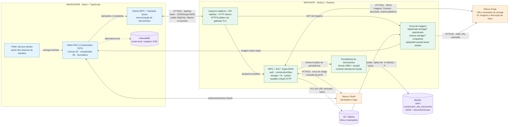
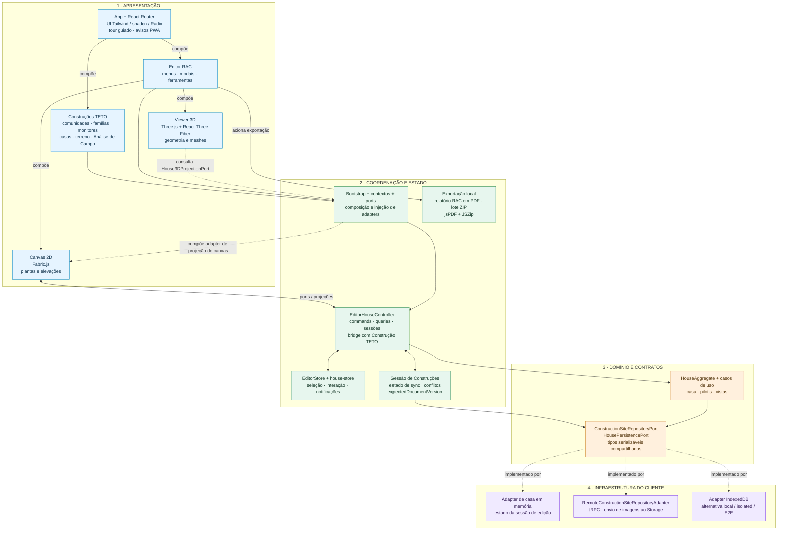
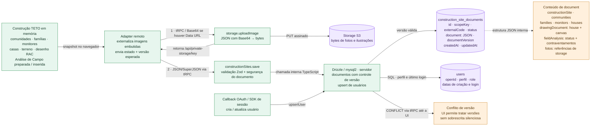

# Arquitetura atual do RAC Designer TETO

## Contexto e recorte

Esta nota descreve os módulos, camadas, protocolos e persistência do RAC Designer TETO. Ela
complementa as convenções do [playbook de engenharia](../engineering-playbook/README.md) e a
disciplina de [Ports and Adapters no Editor
RAC](../engineering-playbook/PLAY-006-ports-and-adapters.md). A descrição se baseia nas fontes do
repositório; disponibilidade e configuração dos serviços dependem do ambiente de execução.

Os três arquivos Mermaid são as fontes canônicas dos diagramas. Os blocos desta nota devem
permanecer sincronizados com eles. Os PNGs são ilustrações auxiliares; os contratos de módulos,
rotas e persistência seguem as fontes Mermaid e o código.

### Artefatos do pacote

O [manifesto de preservação](TECH-001-arquitetura-atual.assets/manifesto.json) associa nomes e
hashes às fontes e imagens. A tabela relaciona os PNGs disponíveis aos identificadores do manifesto:

| Visão                     | PNG disponível                                                                               | Identificador no manifesto |
|---------------------------|----------------------------------------------------------------------------------------------|----------------------------|
| 01 · Macro                | [01-arquitetura-macro.png](TECH-001-arquitetura-atual.assets/01-arquitetura-macro.png)       | `macro.png`                |
| 02 · Camadas e módulos    | [02-camadas-e-modulos.png](TECH-001-arquitetura-atual.assets/02-camadas-e-modulos.png)       | `camadas.png`              |
| 03 · Dados e persistência | [03-dados-e-persistencia.png](TECH-001-arquitetura-atual.assets/03-dados-e-persistencia.png) | `dados.png`                |

Os contratos de fotos, ledger e backup estão no [TECH-002](../TECH-002-contrato-fotos-privadas.md) e
no [OPS-002](../OPS-002-backup-storage.md).

## Escolha da visão

Público: pessoas responsáveis pelo produto e pela manutenção técnica. Os `.mmd` são canônicos; os
blocos abaixo são cópias sincronizadas para leitura nesta nota.

| Visão                                                                                      | Pergunta principal                                                                 | Nível de detalhe e navegação                                                                                                                                                |
|--------------------------------------------------------------------------------------------|------------------------------------------------------------------------------------|-----------------------------------------------------------------------------------------------------------------------------------------------------------------------------|
| [01 · Macro](TECH-001-arquitetura-atual.assets/01-arquitetura-macro.mmd)                   | Onde o aplicativo executa e como conversa com API, identidade, IA e armazenamento? | Fronteiras de execução e serviços; navegador e servidor abrem seus módulos principais. Detalhes internos na 02 e escrita na 03.                                             |
| [02 · Camadas e módulos](TECH-001-arquitetura-atual.assets/02-camadas-e-modulos.mmd)       | Como a interface usa coordenação, domínio, ports e adapters?                       | Responsabilidades internas do navegador, não serviços implantados separadamente. O nó UI da 01 é detalhado aqui.                                                            |
| [03 · Dados e persistência](TECH-001-arquitetura-atual.assets/03-dados-e-persistencia.mmd) | Onde são gravados documento, imagens e usuários, e o que ocorre em conflito?       | Etapas de escrita, tabelas e estrutura JSON; detalha DATA/DB/S3 da 01 e REMOTE/SYNC da 02. Leituras, exclusões e armazenamentos auxiliares estão descritos após o diagrama. |

## Como ler

- O navegador executa o editor e suas regras de domínio. A API Node/Express atende autenticação,
  documentos e integrações.

- A persistência normal usa MySQL: uma linha por Construção TETO, com casas, famílias e monitores
  dentro de um documento JSON.

- Fotos e ilustrações são objetos no S3; o documento guarda referências de Storage.

- IndexedDB é a alternativa para execução local/isolada e E2E, não um espelho offline geral da base
  remota.

- As setas internas do frontend representam chamadas/dados TypeScript no mesmo processo do
  navegador. As conexões externas têm protocolo indicado.

- O agrupamento “API” inclui os handlers HTTP de autenticação; o callback OAuth fica fora do
  endpoint tRPC.

- No modo público, o código prevê HTTPS no gateway e HTTP até Express. Porta e TLS da conexão MySQL
  não foram confirmados.

- O PWA guarda arquivos da interface. Autenticação, sincronização e serviços remotos exigem conexão.

- A base de construções é global e compartilhada entre usuários autenticados no MVP; o campo role
  existe, mas não segmenta essa base.

- Os diagramas representam arquitetura implementada, não atestam configuração ou disponibilidade das
  integrações em produção.

### Significado das setas e agrupamentos

- Na **01**, setas contínuas indicam chamadas, trocas ou transmissão conforme o rótulo; duas pontas
  indicam requisição e resposta. A seta S3 → PROXY mostra os bytes da resposta ao GET feito pelo
  proxy. Pontilhados indicam a alternativa local e a disponibilização dos arquivos da interface.

- Na **02**, setas contínuas sem rótulo indicam uso/dependência do módulo de origem para o destino,
  não transmissão HTTP. As rotuladas indicam composição, acionamento ou troca por ports; duas pontas
  indicam colaboração. Pontilhados de CONTRACT para adapters significam “implementado por”, não
  dependência concreta do domínio. O viewer consulta um port; o bootstrap compõe o adapter que
  projeta o snapshot do canvas em dados serializáveis.

- Na **03**, setas contínuas seguem dados e chamadas durante a gravação. O conflito sai da
  persistência e chega à UI através do handler e cliente tRPC, resumidos na seta. O pontilhado DOC →
  CONTENT expande a estrutura interna do mesmo JSON; não representa outro banco.

- Os grupos da **01** são contextos de execução (navegador e processo servidor); os da **02** são
  camadas lógicas dentro do navegador. Não representam segmentação de rede nem prova de isolamento
  de segurança. A **03** mistura intencionalmente etapas, tabelas e uma nota de estrutura para
  explicar a persistência.

- Cilindros representam armazenamento; retângulos representam responsabilidades ou etapas,
  identificadas no texto. Cores apenas reforçam categorias. Chamadas dentro de navegador/servidor
  são TypeScript; rede e formatos estão nos rótulos.

- HTTP(S) acompanha a URL configurada; HTTPS no gateway é o contrato previsto no código, não uma
  verificação da implantação. O fallback Bearer do preview usa `sessionStorage`; a autenticação
  regular usa cookie HttpOnly. O proxy privado atende `/api/private-storage/*` e a rota compatível
  `/manus-storage/*`, ambas com autenticação; `/api/public-assets/:asset` aceita somente os nomes da
  lista pública de apresentação.

## 01 · Visão macro — módulos e conexões

A [fonte macro](TECH-001-arquitetura-atual.assets/01-arquitetura-macro.mmd) apresenta os contextos
de execução e as conexões do aplicativo com a API e os serviços de identidade, armazenamento e IA.

## 02 · Camadas internas — navegador

A [fonte de camadas](TECH-001-arquitetura-atual.assets/02-camadas-e-modulos.mmd) organiza as
responsabilidades do navegador e as dependências entre apresentação, coordenação, domínio, ports e
adapters.

## 03 · Dados — o que vai para cada armazenamento

A [fonte de dados e persistência](TECH-001-arquitetura-atual.assets/03-dados-e-persistencia.mmd)
detalha o upload pela rota privada, as referências de imagens no documento e o controle de versão
por Construção TETO.

## Leituras e armazenamentos complementares

| Cenário                     | Caminho e responsabilidade                                                                                                                                                                                                              |
|-----------------------------|-----------------------------------------------------------------------------------------------------------------------------------------------------------------------------------------------------------------------------------------|
| Listar/carregar construções | Adapter remoto → `constructionSites.list/load` (tRPC protegido) → `server/db.ts` → MySQL. O retorno reconstitui estado e versão no navegador.                                                                                           |
| Remover construção          | `constructionSites.remove` recebe a versão esperada; o servidor verifica versão e permite remover somente o documento com status `archived`. Não representa exclusão de objetos S3.                                                     |
| Salvar imagens e documento  | O servidor envia bytes ao S3; o adapter substitui imagens embutidas por referências antes de salvar o documento MySQL. Upload e gravação do documento são operações distintas; o diagrama não promete transação única entre S3 e MySQL. |
| Alternativa local           | IndexedDB substitui o repositório remoto em `isolated` ou `VITE_E2E`; apenas `isolated` desliga todas as integrações. Não há espelhamento offline geral.                                                                                |
| Preferências e sessão       | `localStorage` guarda configurações do editor; `sessionStorage` participa do fallback de autenticação no preview. Esses estados auxiliares não são a base canônica de construções.                                                      |
| Interface e exportação      | O service worker guarda arquivos da interface, com exclusão das rotas API/Storage no fallback de navegação. PDF/ZIP são produzidos no cliente, sem novo banco remoto.                                                                   |

## Coerência entre as visões

- UI/CLIENT da macro correspondem à apresentação, sessão e adapter remoto na 02; ADAPTER na 03 é
  esse mesmo adapter, não um segundo serviço.

- API/DATA da 01 executam SAVE, UPLOAD, LOGIN e SQL da 03. Escritas MySQL passam pelo servidor;
  bytes S3 são enviados pelo servidor, não diretamente pelo navegador.

- DOC e USERS são as tabelas do mesmo MySQL da 01. CONTENT é conteúdo de DOC. O callback OAuth e a
  autenticação pelo SDK podem atualizar USERS; o callback não é seu escritor exclusivo.

- C2 e V3 executam no navegador. O viewer recebe uma projeção serializável do snapshot visual via
  port; nenhum elo da 02 pressupõe servidor 3D.

- A alternativa IndexedDB da 01/02 é outro modo de execução; a 03 descreve a escrita remota.
  `fieldAnalysis` acompanha a casa no JSON, incluindo preparação anterior à inserção no canvas.

## Escopo das visões

As visões cobrem os pontos de entrada HTTP e da interface, a composição de ports, sessões e
adapters, os contratos de documentos, banco, autenticação, storage, IA e configuração PWA. Cada nó
representa uma responsabilidade; as fontes específicas estão na tabela abaixo.

Os diagramas descrevem os contratos do aplicativo com Manus, Forge, S3 e MySQL. Topologia, portas,
TLS, disponibilidade das integrações e políticas operacionais de storage dependem da configuração do
ambiente. Esta nota não atesta o estado de uma implantação.

## Manutenção e validação

Atualize a parte afetada quando mudar uma fronteira, protocolo, contrato de persistência ou
responsabilidade de escrita. Confira a alteração no código e depois nas três visões, preservando
IDs, conexões e ajustes manuais que continuem corretos. Uma mudança apenas de rótulo não justifica
substituir o desenho por listas ou tabelas. Mantenha Mermaid como fonte canônica e PNG como imagem
derivada; não é necessário gerar SVG.

Para validar a consistência das visões, confira os fluxos navegador → API → MySQL, imagem →
referência → documento, OAuth → usuário e UI → ports → domínio/adapters. Verifique o escopo global
autenticado, o controle otimista de versão, o modo IndexedDB e o limite do cache PWA.

No bootstrap há um fallback de storage local quando a sessão não é injetada. A composição normal
injeta a sessão remota ou IndexedDB conforme o modo. Esse fallback não configura sincronização
offline geral.

## Fontes de referência

| Elemento                                                           | Fonte no repositório                                                                                                                                                                                                                                                                 |
|--------------------------------------------------------------------|--------------------------------------------------------------------------------------------------------------------------------------------------------------------------------------------------------------------------------------------------------------------------------------|
| Visão geral e dependências                                         | [README.md](../../README.md); [package.json](../../package.json)                                                                                                                                                                                                                     |
| Entrada HTTP, TLS no gateway, API e arquivos estáticos             | [server/_core/index.ts](../../server/_core/index.ts)                                                                                                                                                                                                                                 |
| Routers, validação, upload e recursos de IA                        | [server/routers.ts](../../server/routers.ts)                                                                                                                                                                                                                                         |
| tRPC HTTP em lote e serialização                                   | [client/src/lib/trpc-client.ts](../../client/src/lib/trpc-client.ts)                                                                                                                                                                                                                 |
| Autenticação OAuth e cookie HttpOnly                               | [server/_core/oauth.ts](../../server/_core/oauth.ts); [server/_core/cookies.ts](../../server/_core/cookies.ts)                                                                                                                                                                       |
| MySQL, tabelas e controle de versão                                | [server/db.ts](../../server/db.ts); [drizzle/schema.ts](../../drizzle/schema.ts)                                                                                                                                                                                                     |
| S3, URLs assinadas e proxy de leitura                              | [server/storage.ts](../../server/storage.ts); [server/_core/storageProxy.ts](../../server/_core/storageProxy.ts)                                                                                                                                                                     |
| Forge: Connect/JSON para imagens e chat/completions para descrição | [server/_core/imageGeneration.ts](../../server/_core/imageGeneration.ts); [server/_core/llm.ts](../../server/_core/llm.ts)                                                                                                                                                           |
| Seleção de persistência remota ou IndexedDB                        | [client/src/bootstrap/useRemoteConstructionSiteSessionStorage.ts](../../client/src/bootstrap/useRemoteConstructionSiteSessionStorage.ts); [client/src/shared/local-runtime.ts](../../client/src/shared/local-runtime.ts)                                                             |
| Imagem embutida convertida em referência antes de salvar           | [client/src/infra/persistence/remote-construction-site-repository.adapter.ts](../../client/src/infra/persistence/remote-construction-site-repository.adapter.ts)                                                                                                                     |
| Camadas do editor e composição                                     | [client/src/bootstrap/editor-bootstrap.ts](../../client/src/bootstrap/editor-bootstrap.ts); [client/src/components/rac-editor/lib/editor-house-controller.ts](../../client/src/components/rac-editor/lib/editor-house-controller.ts)                                                 |
| Projeção para visualização 3D                                      | [client/src/components/rac-editor/@viewer-3d/hooks/useHouse3DViewerModel.ts](../../client/src/components/rac-editor/@viewer-3d/hooks/useHouse3DViewerModel.ts)                                                                                                                       |
| Exportação PDF e ZIP no cliente                                    | [client/src/components/rac-editor/lib/rac-pdf-zip-export.ts](../../client/src/components/rac-editor/lib/rac-pdf-zip-export.ts)                                                                                                                                                       |
| PWA e exclusões de API/Storage                                     | [vite.config.ts](../../vite.config.ts)                                                                                                                                                                                                                                               |
| Fluxo atual de sessão / autenticação de requisições                | [session-headers.ts](../../client/src/_core/session-headers.ts); [sdk.ts](../../server/_core/sdk.ts)                                                                                                                                                                                 |
| Composição e projeção do canvas                                    | [editor-house-ports.ts](../../client/src/bootstrap/editor-house-ports.ts); [canvas-house-3d-projection-port.ts](../../client/src/components/rac-editor/@canvas/lib/canvas-house-3d-projection-port.ts)                                                                               |
| Análise de Campo e documento persistido                            | [HouseFieldAnalysisScreen.tsx](../../client/src/components/construction-site/ui/HouseFieldAnalysisScreen.tsx); [house-field-analysis.ts](../../client/src/shared/types/house-field-analysis.ts); [construction-site.ts](../../client/src/shared/types/construction-site.ts)          |
| Preferências locais                                                | [editor-settings-storage.ts](../../client/src/components/rac-editor/store/editor-settings-storage.ts)                                                                                                                                                                                |
