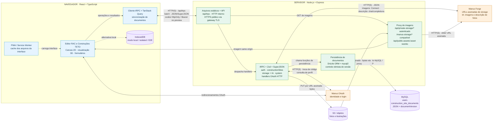
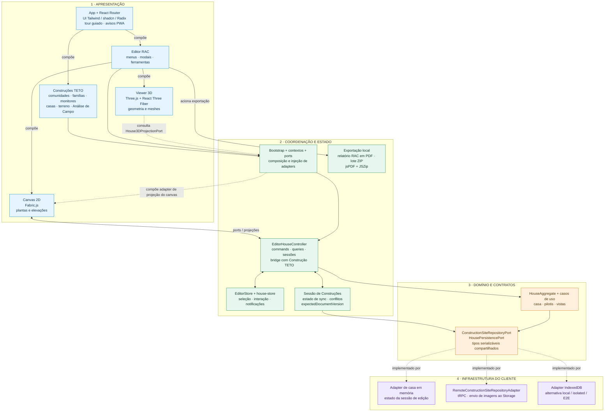
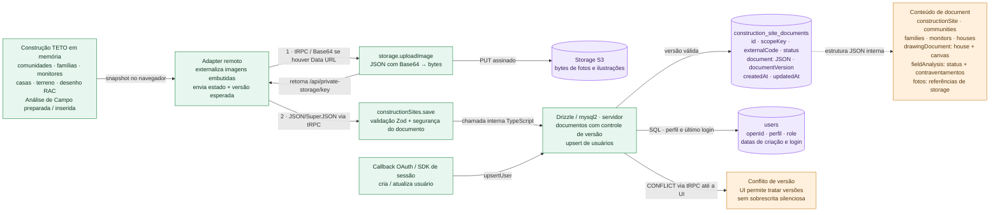

# Arquitetura atual do RAC Designer TETO

## Contexto e recorte

Esta nota descreve a implementação local conferida em **17/10/2026**: módulos, camadas, protocolos e
persistência. Ela complementa as convenções do [playbook de
engenharia](../engineering-playbook/README.md) e a disciplina de [Ports and Adapters no Editor
RAC](../engineering-playbook/PLAY-006-ports-and-adapters.md). Não atesta implantação,
disponibilidade ou configuração de serviços remotos.

Os três arquivos Mermaid deste pacote são a fonte canônica dos diagramas; seus blocos nesta nota
devem permanecer sincronizados. Os PNGs históricos foram representações derivadas aprovadas
visualmente na sessão de origem; seus hashes continuam no manifesto, mas os arquivos não estão
presentes nem versionados neste checkout. Os blocos Mermaid abaixo preservam a leitura conectada das
três visões. Não substituem os contratos do código.

### Atualidade das imagens e das fontes

O manifesto registra o aceite das imagens de 16/10/2026 e a revisão das fontes de 17/10/2026.
Naquela conferência, novos uploads passaram a ser descritos pela rota `/api/private-storage/key`,
mantendo `/manus-storage/*` legível por compatibilidade. As cópias Mermaid corrigiram somente esses
rótulos na macro e na persistência, sem alterar nós, conexões, agrupamentos ou estilos.

Os snapshots Mermaid de 16/10/2026 e os hashes dos arquivos acompanham o [manifesto de
preservação](TECH-001-arquitetura-atual.assets/manifesto.json), para relacionar as imagens
históricas às fontes que as originaram. Essa diferença de rótulo não implica troca de armazenamento:
o servidor continua transferindo bytes para S3 e intermediando a leitura.

A revisão documental de 25/10/2026 não regenerou imagens nem modificou as fontes ou os blocos
Mermaid. A estrutura retratada continua sendo o recorte de 17/10/2026; os contratos posteriores de
fotos, ledger e backup estão no [TECH-002](../TECH-002-contrato-fotos-privadas.md) e no
[OPS-002](../OPS-002-backup-storage.md). O manifesto histórico não atesta a disponibilidade atual
dos PNGs nem representa uma nova validação da arquitetura ou do ambiente publicado.

## Escolha da visão

Público: pessoas responsáveis pelo produto e pela manutenção técnica. Os `.mmd` são canônicos; os
blocos abaixo são cópias sincronizadas para leitura nesta nota.

| Visão                                                                                      | Pergunta principal                                                                 | Nível de detalhe e navegação                                                                                                                                                |
|--------------------------------------------------------------------------------------------|------------------------------------------------------------------------------------|-----------------------------------------------------------------------------------------------------------------------------------------------------------------------------|
| [01 · Macro](TECH-001-arquitetura-atual.assets/01-arquitetura-macro.mmd)                   | Onde o aplicativo executa e como conversa com API, identidade, IA e armazenamento? | Fronteiras de execução e serviços; navegador e servidor abrem seus módulos principais. Detalhes internos na 02 e escrita na 03.                                             |
| [02 · Camadas e módulos](TECH-001-arquitetura-atual.assets/02-camadas-e-modulos.mmd)       | Como a interface usa coordenação, domínio, ports e adapters?                       | Responsabilidades internas do navegador, não serviços implantados separadamente. O nó UI da 01 é detalhado aqui.                                                            |
| [03 · Dados e persistência](TECH-001-arquitetura-atual.assets/03-dados-e-persistencia.mmd) | Onde são gravados documento, imagens e usuários, e o que ocorre em conflito?       | Etapas de escrita, tabelas e estrutura JSON; detalha DATA/DB/S3 da 01 e REMOTE/SYNC da 02. Leituras, exclusões e armazenamentos auxiliares estão descritos após o diagrama. |

## Como ler

- O navegador executa o editor e suas regras de domínio. A API Node/Express atende autenticação,
  documentos e integrações.

- A persistência normal usa MySQL: uma linha por Construção TETO, com casas, famílias e monitores
  dentro de um documento JSON.

- Fotos e ilustrações são objetos no S3; o documento guarda referências de Storage.

- IndexedDB é a alternativa para execução local/isolada e E2E, não um espelho offline geral da base
  remota.

- As setas internas do frontend representam chamadas/dados TypeScript no mesmo processo do
  navegador. As conexões externas têm protocolo indicado.

- O agrupamento “API” inclui os handlers HTTP de autenticação; o callback OAuth fica fora do
  endpoint tRPC.

- No modo público, o código prevê HTTPS no gateway e HTTP até Express. Porta e TLS da conexão MySQL
  não foram confirmados.

- O PWA guarda arquivos da interface. Autenticação, sincronização e serviços remotos exigem conexão.

- A base de construções é global e compartilhada entre usuários autenticados no MVP; o campo role
  existe, mas não segmenta essa base.

- Os diagramas representam arquitetura implementada, não atestam configuração ou disponibilidade das
  integrações em produção.

### Significado das setas e agrupamentos

- Na **01**, setas contínuas indicam chamadas, trocas ou transmissão conforme o rótulo; duas pontas
  indicam requisição e resposta. A seta S3 → PROXY mostra os bytes da resposta ao GET feito pelo
  proxy. Pontilhados indicam a alternativa local e a disponibilização dos arquivos da interface.

- Na **02**, setas contínuas sem rótulo indicam uso/dependência do módulo de origem para o destino,
  não transmissão HTTP. As rotuladas indicam composição, acionamento ou troca por ports; duas pontas
  indicam colaboração. Pontilhados de CONTRACT para adapters significam “implementado por”, não
  dependência concreta do domínio. O viewer consulta um port; o bootstrap compõe o adapter que
  projeta o snapshot do canvas em dados serializáveis.

- Na **03**, setas contínuas seguem dados e chamadas durante a gravação. O conflito sai da
  persistência e chega à UI através do handler e cliente tRPC, resumidos na seta. O pontilhado DOC →
  CONTENT expande a estrutura interna do mesmo JSON; não representa outro banco.

- Os grupos da **01** são contextos de execução (navegador e processo servidor); os da **02** são
  camadas lógicas dentro do navegador. Não representam segmentação de rede nem prova de isolamento
  de segurança. A **03** mistura intencionalmente etapas, tabelas e uma nota de estrutura para
  explicar a persistência.

- Cilindros representam armazenamento; retângulos representam responsabilidades ou etapas,
  identificadas no texto. Cores apenas reforçam categorias. Chamadas dentro de navegador/servidor
  são TypeScript; rede e formatos estão nos rótulos.

- HTTP(S) acompanha a URL configurada; HTTPS no gateway é o contrato previsto no código, não uma
  verificação da implantação. O fallback Bearer do preview usa `sessionStorage`; a autenticação
  regular usa cookie HttpOnly. O proxy privado atende `/api/private-storage/*` e a rota compatível
  `/manus-storage/*`, ambas com autenticação; `/api/public-assets/:asset` aceita somente os nomes da
  lista pública de apresentação.

## 01 · Visão macro — módulos e conexões

O Mermaid abaixo inclui a rota privada e sua compatibilidade no recorte documentado. A [fonte macro
versionada](TECH-001-arquitetura-atual.assets/01-arquitetura-macro.mmd) permite ler e renderizar o
diagrama sem depender do PNG histórico ausente.

## 02 · Camadas internas — navegador

O Mermaid preserva as responsabilidades e conexões documentadas. A [fonte de camadas
versionada](TECH-001-arquitetura-atual.assets/02-camadas-e-modulos.mmd) permite renderizar a visão
sem depender do PNG histórico ausente.

## 03 · Dados — o que vai para cada armazenamento

O retorno de upload na imagem histórica usava a rota `/manus-storage/key`; a [fonte de dados
versionada](TECH-001-arquitetura-atual.assets/03-dados-e-persistencia.mmd) e o Mermaid abaixo
registram a rota `/api/private-storage/key`. O PNG histórico não é necessário para consultar essa
fonte.

## Leituras e armazenamentos complementares

| Cenário                     | Caminho e responsabilidade                                                                                                                                                                                                              |
|-----------------------------|-----------------------------------------------------------------------------------------------------------------------------------------------------------------------------------------------------------------------------------------|
| Listar/carregar construções | Adapter remoto → `constructionSites.list/load` (tRPC protegido) → `server/db.ts` → MySQL. O retorno reconstitui estado e versão no navegador.                                                                                           |
| Remover construção          | `constructionSites.remove` recebe a versão esperada; o servidor verifica versão e permite remover somente o documento com status `archived`. Não representa exclusão de objetos S3.                                                     |
| Salvar imagens e documento  | O servidor envia bytes ao S3; o adapter substitui imagens embutidas por referências antes de salvar o documento MySQL. Upload e gravação do documento são operações distintas; o diagrama não promete transação única entre S3 e MySQL. |
| Alternativa local           | IndexedDB substitui o repositório remoto em `isolated` ou `VITE_E2E`; apenas `isolated` desliga todas as integrações. Não há espelhamento offline geral.                                                                                |
| Preferências e sessão       | `localStorage` guarda configurações do editor; `sessionStorage` participa do fallback de autenticação no preview. Esses estados auxiliares não são a base canônica de construções.                                                      |
| Interface e exportação      | O service worker guarda arquivos da interface, com exclusão das rotas API/Storage no fallback de navegação. PDF/ZIP são produzidos no cliente, sem novo banco remoto.                                                                   |

## Coerência entre as visões

- UI/CLIENT da macro correspondem à apresentação, sessão e adapter remoto na 02; ADAPTER na 03 é
  esse mesmo adapter, não um segundo serviço.

- API/DATA da 01 executam SAVE, UPLOAD, LOGIN e SQL da 03. Escritas MySQL passam pelo servidor;
  bytes S3 são enviados pelo servidor, não diretamente pelo navegador.

- DOC e USERS são as tabelas do mesmo MySQL da 01. CONTENT é conteúdo de DOC. O callback OAuth e a
  autenticação pelo SDK podem atualizar USERS; o callback não é seu escritor exclusivo.

- C2 e V3 executam no navegador. O viewer recebe uma projeção serializável do snapshot visual via
  port; nenhum elo da 02 pressupõe servidor 3D.

- A alternativa IndexedDB da 01/02 é outro modo de execução; a 03 descreve a escrita remota.
  `fieldAnalysis` acompanha a casa no JSON, incluindo preparação anterior à inserção no canvas.

## Cobertura e critério de encerramento

Foram consultados os pontos de entrada HTTP e da interface, composição de ports, sessão/adapters,
contratos de documentos, schema e funções de banco, autenticação, storage, IA, dependências e
configuração PWA deste repositório (`client/`, `server/`, `shared/`, `drizzle/`, `vite.config.ts`,
`package.json` e documentação relacionada). As fontes específicas estão na tabela abaixo.

A investigação foi encerrada após responder às três perguntas e conferir os caminhos relevantes até
suas interfaces externas. Não houve inspeção recursiva do código interno de Manus/Forge/S3, nem
auditoria de cada função do editor. Nós representam responsabilidades, não cada arquivo.
Configurações auxiliares estão resumidas na tabela anterior para manter as visões legíveis.

Limites: implantação publicada, disponibilidade de integrações, topologia/portas/TLS efetivos do
MySQL e políticas operacionais de storage não foram verificados. Esses pontos permanecem
desconhecidos; não impedem descrever a implementação local. Uma nova dependência relevante ou uma
contradição com as fontes reabre somente a parte afetada da investigação.

## Manutenção e validação

Atualize a parte afetada quando mudar uma fronteira, protocolo, contrato de persistência ou
responsabilidade de escrita. Confira a alteração no código e depois nas três visões, preservando
IDs, conexões e ajustes manuais que continuem corretos. Uma mudança apenas de rótulo não justifica
substituir o desenho por listas ou tabelas. Mantenha Mermaid como fonte canônica e PNG como imagem
derivada; não é necessário gerar SVG.

A conferência de 17/10/2026 seguiu os caminhos navegador → API → MySQL, imagem → referência →
documento, OAuth → usuário e UI → ports → domínio/adapters. Confirmou o escopo global autenticado, o
controle otimista de versão, a alternativa IndexedDB e o limite do cache PWA. No bootstrap há um
fallback de storage local quando a sessão não é injetada; a composição normal injeta a sessão remota
ou IndexedDB conforme o modo. Isso não configura sincronização offline geral.

A promoção preserva os 12 componentes/15 relações da macro, 15/19 de camadas e 11/11 de dados. A
revisão visual e o aceite anteriores dos PNGs permanecem registrados no manifesto; não representam
uma nova geração nem validação no ambiente publicado. A conferência de 25/10/2026 verifica os links
e preserva as fontes disponíveis; não declara recuperação dos PNGs ausentes. A estrutura e a
equivalência das cópias Mermaid são conferidas separadamente da renderização visual.

## Proveniência local

O levantamento anterior de 05/10/2026 e o manifesto de imagens de outra rodada foram substituídos
por esta nota na reorganização do pacote. Suas versões permanecem recuperáveis no histórico do
repositório; os insumos locais de geração continuam preservados. Esta nota e seus assets são a
referência atualizada para as três visões. Não trate os rótulos antigos como contrato vigente.

O levantamento inicial ocorreu em 05/10/2026 e foi revisado em 16/10/2026. Os insumos locais foram
output/arquitetura-macro-diagrams e output/arquitetura-imagegen-v6.assets/diagrams, com registros em
.agents/changelogs/2026-10/20261016.changelog.md e no work-item de geração. Esses insumos e
tentativas permanecem como evidência local, sem serem necessários para navegar neste pacote. Esta
promoção original registrou fontes, imagens aprovadas e explicações reutilizáveis. No checkout atual
estão disponíveis as fontes e o manifesto; a revisão documental não substitui nem recria as imagens
aprovadas na origem.

## Fontes verificadas

| Elemento                                                           | Fonte no repositório                                                                                                                                                                                                                                                                 |
|--------------------------------------------------------------------|--------------------------------------------------------------------------------------------------------------------------------------------------------------------------------------------------------------------------------------------------------------------------------------|
| Visão geral e dependências                                         | [README.md](../../README.md); [package.json](../../package.json)                                                                                                                                                                                                                     |
| Entrada HTTP, TLS no gateway, API e arquivos estáticos             | [server/_core/index.ts](../../server/_core/index.ts)                                                                                                                                                                                                                                 |
| Routers, validação, upload e recursos de IA                        | [server/routers.ts](../../server/routers.ts)                                                                                                                                                                                                                                         |
| tRPC HTTP em lote e serialização                                   | [client/src/lib/trpc-client.ts](../../client/src/lib/trpc-client.ts)                                                                                                                                                                                                                 |
| Autenticação OAuth e cookie HttpOnly                               | [server/_core/oauth.ts](../../server/_core/oauth.ts); [server/_core/cookies.ts](../../server/_core/cookies.ts)                                                                                                                                                                       |
| MySQL, tabelas e controle de versão                                | [server/db.ts](../../server/db.ts); [drizzle/schema.ts](../../drizzle/schema.ts)                                                                                                                                                                                                     |
| S3, URLs assinadas e proxy de leitura                              | [server/storage.ts](../../server/storage.ts); [server/_core/storageProxy.ts](../../server/_core/storageProxy.ts)                                                                                                                                                                     |
| Forge: Connect/JSON para imagens e chat/completions para descrição | [server/_core/imageGeneration.ts](../../server/_core/imageGeneration.ts); [server/_core/llm.ts](../../server/_core/llm.ts)                                                                                                                                                           |
| Seleção de persistência remota ou IndexedDB                        | [client/src/bootstrap/useRemoteConstructionSiteSessionStorage.ts](../../client/src/bootstrap/useRemoteConstructionSiteSessionStorage.ts); [client/src/shared/local-runtime.ts](../../client/src/shared/local-runtime.ts)                                                             |
| Imagem embutida convertida em referência antes de salvar           | [client/src/infra/persistence/remote-construction-site-repository.adapter.ts](../../client/src/infra/persistence/remote-construction-site-repository.adapter.ts)                                                                                                                     |
| Camadas do editor e composição                                     | [client/src/bootstrap/editor-bootstrap.ts](../../client/src/bootstrap/editor-bootstrap.ts); [client/src/components/rac-editor/lib/editor-house-controller.ts](../../client/src/components/rac-editor/lib/editor-house-controller.ts)                                                 |
| Projeção para visualização 3D                                      | [client/src/components/rac-editor/@viewer-3d/hooks/useHouse3DViewerModel.ts](../../client/src/components/rac-editor/@viewer-3d/hooks/useHouse3DViewerModel.ts)                                                                                                                       |
| Exportação PDF e ZIP no cliente                                    | [client/src/components/rac-editor/lib/rac-pdf-zip-export.ts](../../client/src/components/rac-editor/lib/rac-pdf-zip-export.ts)                                                                                                                                                       |
| PWA e exclusões de API/Storage                                     | [vite.config.ts](../../vite.config.ts)                                                                                                                                                                                                                                               |
| Fluxo atual de sessão / autenticação de requisições                | [session-headers.ts](../../client/src/_core/session-headers.ts); [sdk.ts](../../server/_core/sdk.ts)                                                                                                                                                                                 |
| Composição e projeção do canvas                                    | [editor-house-ports.ts](../../client/src/bootstrap/editor-house-ports.ts); [canvas-house-3d-projection-port.ts](../../client/src/components/rac-editor/@canvas/lib/canvas-house-3d-projection-port.ts)                                                                               |
| Análise de Campo e documento persistido                            | [HouseFieldAnalysisScreen.tsx](../../client/src/components/construction-site/ui/HouseFieldAnalysisScreen.tsx); [house-field-analysis.ts](../../client/src/shared/types/house-field-analysis.ts); [construction-site.ts](../../client/src/shared/types/construction-site.ts)          |
| Preferências locais                                                | [editor-settings-storage.ts](../../client/src/components/rac-editor/store/editor-settings-storage.ts)                                                                                                                                                                                |
